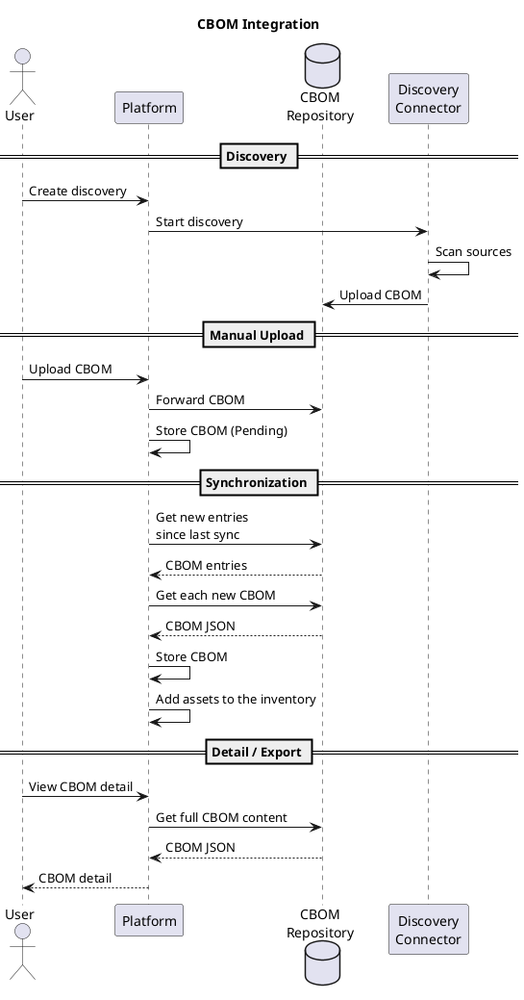

# CBOM

`CBOM` (Cryptographic Bill of Materials) is a standardized inventory of cryptographic assets based on the [CycloneDX](https://cyclonedx.org) specification. The platform supports [CycloneDX v1.6](https://cyclonedx.org/docs/1.6/json/) and [v1.7](https://cyclonedx.org/docs/1.7/json/) and provides inventory, management, and visualization of CBOM documents containing cryptographic assets such as certificates, keys, algorithms, protocols, and secrets. The cryptographic assets of the synchronized `CBOMs` are collected in the [Cryptographic Asset Inventory](../modules/cryptographic-asset-inventory.md). `CBOMs` are listed under **CBOMs** in the main menu.

## CBOM Properties

Each `CBOM` document in the platform is tracked with the following properties:

| Property         | Description                                                                                                                                                                                                                            |
|------------------|----------------------------------------------------------------------------------------------------------------------------------------------------------------------------------------------------------------------------------------|
| Serial Number    | Unique identifier of the CBOM document (URN)                                                                                                                                                                                           |
| Version          | Version number of the CBOM document                                                                                                                                                                                                    |
| Spec Version     | Version of the CycloneDX specification, shown on the detail only                                                                                                                                                                       |
| Source           | The component name in the document metadata. CBOM Lens writes its own name there, `CBOM-Lens`; other producers usually write the system the `CBOM` describes, for example `payments-service`. An asset detail shows it as **Producer** |
| Timestamp        | Timestamp from the CBOM document metadata                                                                                                                                                                                              |
| Certificates     | Number of certificate assets                                                                                                                                                                                                           |
| Algorithms       | Number of algorithm assets                                                                                                                                                                                                             |
| Protocols        | Number of protocol assets                                                                                                                                                                                                              |
| Crypto Material  | Number of related cryptographic material items                                                                                                                                                                                         |
| Total Assets     | Total number of all cryptographic assets                                                                                                                                                                                               |
| Asset Sync State | How far the assets of the `CBOM` have been added to the inventory, see [Asset sync states](#asset-sync-states)                                                                                                                         |
| Assets Synced At | When the assets of the `CBOM` were last added to the inventory                                                                                                                                                                         |
| Asset Sync Error | Why the last attempt to add the assets of the `CBOM` to the inventory failed                                                                                                                                                           |

In the list, Version, Certificates, Algorithms, Protocols, Crypto Material and Total Assets are headed **Ver.**, **Certs**, **Alg.**, **Proto.**, **Material** and **Assets**. Timestamp and the three asset sync properties are optional columns, added with **Add column**, the **+** at the right end of the column headings. The list can be filtered by every property except Spec Version; the asset counts are named with `Count`, for example **Algorithms Count**. The **Has Contributed Assets** filter finds the `CBOMs` whose assets are in the inventory now.

Multiple versions of the same `CBOM` (identified by serial number) are tracked, allowing historical comparison of cryptographic asset changes over time. The inventory follows the synchronized version with the highest version number, see [Versions and deletion](#versions-and-deletion).

## Specification versions

Both CycloneDX v1.6 and v1.7 are accepted. The `Spec Version` property records which specification a stored document conforms to, so an inventory can contain a mixture of both. A document of any other version is refused.

v1.7 is additive for cryptographic assets: it introduces a registry of algorithm families and elliptic curves, typed relationships between crypto assets, and richer certificate metadata. A v1.6 document therefore remains valid and does not need to be regenerated.

## CBOM Sources

`CBOMs` reach the platform through the following methods. Every `CBOM` is stored in the CBOM Repository, and its assets reach the inventory through [synchronization](#synchronization).

### Discovery

Cryptographic assets can be automatically discovered using a `Connector` implementing the `Discovery Provider` `Function Group`, see [Certificate Discovery](../modules/certificate-discovery.md). Discovered CBOM documents are stored in the CBOM Repository and synchronized with the platform.

[CBOM Lens](https://github.com/OmniTrustILM/cbom-lens) is one such tool. It discovers cryptographic assets in filesystems, container images, and network endpoints. In discovery mode it registers itself in the platform as a `Connector` with the status `Waiting for approval`. Once the `Connector` is approved under **Connectors**, a discovery created with it scans with the configuration given in its `Attributes`. The discovery itself returns no certificates: the `CBOM` it produces appears in the CBOM list after the next sync run. CBOM Lens can also scan on its own schedule and upload its `CBOMs` to the CBOM Repository directly.

### CBOM Repository synchronization

The platform synchronizes with the CBOM Repository every hour. It stores every new CBOM document the repository holds, whoever uploaded it. Synchronization can also be started manually, see [Synchronization](#synchronization). The CBOM Repository URL must be configured in [Platform Settings](../../settings/platform.md#util-settings) to enable synchronization.

### Manual upload

The upload icon in the **CBOMs** header (tooltip "Upload CBOM") opens a dialog for a CycloneDX document in JSON or YAML. Paste the document, drop a file on it, or choose one with **Select file...**. The platform forwards the document to the CBOM Repository, which checks it against the CycloneDX schema of its specification version. A document that does not conform is refused with the reason. A `version` given in the document must be a whole number from 1 upwards. Otherwise the upload is refused with *Invalid CBOM version. Version must be an integer from 1 to 2147483647. Example: 1*. The uploaded `CBOM` appears in the list at once, with the asset sync state `Pending`. A following sync run adds its assets to the inventory.

## CBOM operations

The platform offers the following list of operations from the CBOM list, the CBOM detail and the **Skipped Documents** page:

| Operation                    | Description                                                                                                                                                                       |
|------------------------------|-----------------------------------------------------------------------------------------------------------------------------------------------------------------------------------|
| Upload `CBOM`                | The upload icon in the **CBOMs** header uploads a CycloneDX document, see [Manual upload](#manual-upload).                                                                        |
| Synchronize `CBOMs`          | The sync icon in the **CBOMs** header (tooltip "Sync CBOMs") starts a sync run at once, in addition to the scheduled ones.                                                        |
| View `CBOM` detail           | The serial number opens the detail with the tabs **Overview**, **Assets** and **Raw JSON**.                                                                                       |
| View versions                | The version selector of the detail switches between the versions of the `CBOM`; **View Version History** lists all of them.                                                       |
| View assets in the inventory | On the detail of a synchronized `CBOM`, assets that are in the inventory link to their entry. **View the assets of this CBOM in the crypto asset inventory** lists them together. |
| Copy or download `CBOM`      | The copy and download icons in the serial number cell, shown on hover (tooltips "Copy JSON" and "Download JSON"), copy or download the document.                                  |
| Delete `CBOM`                | The trash icon in the **CBOMs** header (tooltip "Delete"), enabled once rows are checked, removes the checked `CBOMs`, see [Versions and deletion](#versions-and-deletion).       |
| Retry a skipped document     | The retry icon in the **Actions** column sends a permanently skipped document back to the next sync run, see [Skipped documents](#skipped-documents).                             |

Access to `CBOMs` is granted through the **Cboms** resource of a role, see [Roles and Permissions](../architecture/access-control/roles-permissions.md).

## Synchronization

Three scheduled jobs keep the `CBOMs` of the platform in step with the CBOM Repository. The [Scheduler](../architecture/scheduler.md#supported-task-types) lists them under these names:

| Job                         | When (UTC)              | What it does                                                                                                     |
|-----------------------------|-------------------------|------------------------------------------------------------------------------------------------------------------|
| `CbomSyncTask`              | Every hour, on the hour | Stores the CBOM documents added to the CBOM Repository since its last run and adds their assets to the inventory |
| `CbomReconcileTask`         | Sundays at 02:30        | Reads the whole CBOM Repository and stores every document the hourly runs missed                                 |
| `CbomSyncSkipRetentionTask` | Every day at 03:15      | Removes old permanently [skipped documents](#skipped-documents)                                                  |

The sync icon on the CBOM list starts the same run as the hourly job at once. Nothing is synchronized while no CBOM Repository URL is configured, although a manual sync still reports *CBOMs successfully synchronized.* A scheduled run is skipped while the URL is missing or the CBOM Repository cannot be reached. The job then shows the reason in **Last Skip Reason**.

Each run adds to the inventory the assets of the documents it has just stored. It also adds the assets of up to **CBOM Sync Catch-up** further `CBOMs` that still wait for them: uploaded `CBOMs` first, then those whose earlier attempt failed or was interrupted. If `CBOMs` stay `Pending` for many runs, raise **CBOM Sync Catch-up**, or start extra runs with the sync icon. **CBOM Sync Overlap**, **CBOM Sync Retries**, **CBOM Sync Catch-up** and **CBOM Sync Skip Retention** are set on the **Utils** tab of [Platform Settings](../../settings/platform.md#cbom-synchronization).

### Versions and deletion

When a newer version of a `CBOM` is synchronized, its assets replace those of the earlier version. An asset the newer version no longer declares leaves the inventory, unless another `CBOM` declares it. The earlier version stays in the CBOM list, and its detail says that a later version holds its assets now.

Deleting a `CBOM` removes it from the platform together with the assets that no other `CBOM` declares. The document stays in the CBOM Repository, but synchronization does not store it again; to bring it back, upload it again. Deleting the newest version does not return the assets of the earlier version to the inventory; to restore them, delete the earlier version too and upload it again. A document removed from the CBOM Repository by other means stays in the platform with its assets until it is deleted here. Its detail then shows only *This CBOM no longer exists in the repository. Please synchronize the inventory.*; synchronizing does not change that.

### Asset sync states

The **Asset Sync State** column and filter of the CBOM list, and the detail of a `CBOM` above its assets, show how far its assets have come:

| State         | Description                                                                                                                                                                                              |
|---------------|----------------------------------------------------------------------------------------------------------------------------------------------------------------------------------------------------------|
| `Pending`     | The assets have not been added to the inventory yet. An uploaded `CBOM` waits here for a sync run.                                                                                                       |
| `In progress` | A sync run is adding the assets to the inventory.                                                                                                                                                        |
| `Synced`      | The assets are in the inventory. An earlier version stays `Synced` after a newer version has replaced it.                                                                                                |
| `Failed`      | The last attempt failed and **Asset Sync Error** says why. Later runs try again. A document refused for its content stays `Failed` after the third refusal; the producer's fix arrives as a new version. |

### Skipped documents

A document that a sync run cannot read from the CBOM Repository, or cannot store, does not appear in the CBOM list. It is listed on the **Skipped Documents** page instead, with the **Reason** of its last attempt. The page opens from the skipped-documents icon in the **CBOMs** header (tooltip "Skipped documents: what the sync could not store").

| State                 | Description                                                                                                                      |
|-----------------------|----------------------------------------------------------------------------------------------------------------------------------|
| `Retrying`            | The next sync runs try the document again, up to [**CBOM Sync Retries**](../../settings/platform.md#cbom-synchronization) times. |
| `Permanently skipped` | The retries are spent. The weekly reconciliation still tries the document while the repository lists it.                         |

Once the cause is fixed, use the retry icon in the **Actions** column of a permanently skipped document (tooltip "Retry on the next sync run") and confirm with **Retry**. The next sync run then tries the document again, with a full set of retries. A document leaves the page when a run stores it. A permanently skipped document is also removed [**CBOM Sync Skip Retention**](../../settings/platform.md#cbom-synchronization) days after its last attempt. When many are due, the daily job removes them over several days; nothing needs to be configured. A document that keeps failing while the repository lists it is tried again by every weekly reconciliation, so it stays on the page; with a **CBOM Sync Skip Retention** shorter than a week it can be removed and then comes back as `Retrying`. A corrected version from the producer is a new document and leaves this entry in place. The platform cannot dismiss the entry: it goes away only when whoever administers the CBOM Repository removes the document from the repository's storage. Until then it is harmless and can be ignored.

## Integration with CBOM Repository

The [CBOM Repository](https://github.com/OmniTrustILM/cbom-repository) is a service that provides centralized storage and versioning of CBOM documents. It serves as the single source of truth for all CBOM content.

The platform stores the `CBOM` properties and the inventory built from the documents locally, for listing and search. When full CBOM content is needed (for the detail view, or to copy or download the document), it is fetched on demand from the CBOM Repository.

The following diagram illustrates the integration between the platform, CBOM Repository, and discovery:

## See Also

- [CycloneDX v1.6 specification](https://cyclonedx.org/docs/1.6/json/)
- [CycloneDX v1.7 specification](https://cyclonedx.org/docs/1.7/json/)
- [Cryptographic Asset Inventory](../modules/cryptographic-asset-inventory.md)
- [Post-Quantum Readiness](../architecture/post-quantum-readiness.md)
- [Certificate](certificate.md)
- [Key](key.md)
