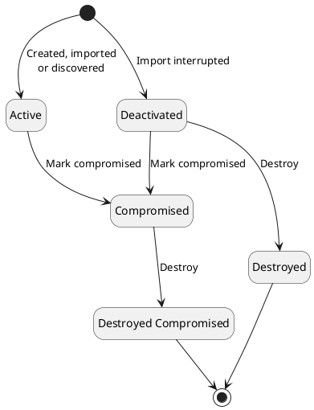

# Key

The `Key` holds the information about the cryptographic key and its lifecycle. It represents the cryptographic key in a human-readable format. `Key` holds the following information:

- `Key` management details
- Attributes of the `Key`
- Association with other related objects like `Certificate`
- [History of events](#key-history) associated with the `Key`
- Wrapped content of other related parts of the `Key`, for example public/private key, or split/component parts

In addition to the above details, the following are mapped to the `Key` for the ease of management:

- `Token Profile` it belongs to and managed by
- Owner of the `Key`
- `Group` it belongs to
- Optionally description of the `Key`

A `Key` found by a discovery belongs to no `Token Profile`, see [Discovered keys](../modules/key-inventory.md#discovered-keys).

## Attributes

`Key` attributes hold information related to the platform. It can contain Custom Attributes as well as Metadata Attributes.

Metadata Attributes provides any additional information about the `Key` that can be technology specific.
They can be used for further processing of the `Key` by different components and modules of the platform.

## Key state

Every key has defined its state during its lifecycle. The state of the `Key` defines its lifecycle phase and operations that can be performed.
A new `Key` is `Active`. A `Key` created in a `Token Profile` starts disabled unless its create request enables it, and an imported `Key` starts disabled; enable it before it is used. Cryptographic operations and export need the `Key` to be `Active` and enabled.

The following states are supported:

| State                   | Description                                                                                                                    |
|-------------------------|--------------------------------------------------------------------------------------------------------------------------------|
| `Active`                | The `Key` can be used while it is enabled                                                                                      |
| `Deactivated`           | The `Key` cannot be used. A `Key` whose import was interrupted is registered in this state when the cryptography provider refuses to remove it |
| `Compromised`           | The `Key` is compromised and cannot be used, however it still exists                                                           |
| `Destroyed`             | The `Key` is destroyed, however it is still in the inventory for auditing purposes                                             |
| `Destroyed Compromised` | A compromised `Key` that was destroyed, still in the inventory for auditing purposes                                           |

The API also defines the `Pre-active` state, but the platform puts no `Key` in it.

The transition `Key` state diagram is as follows:

## Key usage

Every key has defined its key usages. The key usage can restrict the type of cryptographic operation that can be performed using the `Key`.

Key usages are platform policy. The platform checks them before it sends an operation to the connector. The connector can also restrict the key where it stores it, for example with the PKCS#11 `CKA_SIGN` flag, when it creates the key.

The following key usages are supported:

| Key Usage | Description                                              |
|-----------|----------------------------------------------------------|
| `Encrypt` | Allows to request encryption operation using the `Key`   |
| `Decrypt` | Allows to request decryption operation using the `Key`   |
| `Sign`    | Allows to request signing operation using the `Key`      |
| `Verify`  | Allows to request verification operation using the `Key` |
| `Wrap`    | Allows to request wrapping operation using the `Key`     |
| `Unwrap`  | Allows to request unwrapping operation using the `Key`   |

The supported key usages and key types combinations are:

| Key Type      | Key Usage                                                |
|---------------|----------------------------------------------------------|
| `Public Key`  | `Encrypt`, `Verify`, `Wrap`                              |
| `Private Key` | `Decrypt`, `Sign`, `Unwrap`                              |
| `Secret Key`  | `Encrypt`, `Decrypt`, `Sign`, `Verify`, `Wrap`, `Unwrap` |

## Exportable

Each private and secret key item carries an exportable flag that decides whether its key material can ever leave the cryptography provider:

- The flag is set when the `Key` is created or imported, and it is off unless it is switched on then. The platform accepts it only where the `Token Profile`'s provider exports the key's type, and for an imported key also its algorithm.
- It can be switched off later through the [disable key export](/api/core-key#tag/cryptographic-key-management/PATCH/v1/keys/{uuid}/items/{keyItemUuid}/export/disable) operation, but never switched on again.
- Discovered keys and public key items are never exportable.

An exportable item is exported only while it is active and enabled.

## Import and export

Import and export move key material between a file and the cryptography provider without the platform keeping it. They need a `Token` on Cryptography Provider v2 whose connector supports key import or key export, and they cover only the key types and algorithms the connector supports for the key's `Token Profile`. The Software Cryptography Provider supports both, and the PKCS#11 Cryptography Provider neither. A `Token` created on Cryptography Provider v1 stays on v1 after its connector is upgraded, and supports neither; see [`Token`](token.md#cryptography-provider).

- On import, `Core` reads the file with the password the user gives, and the password never leaves `Core`. `Core` protects the key again under a one-time passphrase and hands it to the provider, which opens it and stores it. `Core` keeps no way to decrypt the key afterwards.
- On export, the provider protects the key under the user's password, and `Core` passes it on without decrypting it.
- Between `Core` and the provider, the protected key travels together with the passphrase that opens it. The connection to the connector must therefore be protected as it is for connector credentials, for example with an `https` connector URL, and so must the message broker for a connector reached through a proxy.
- A key file uploaded without a password is protected on its way to `Core` only by the connection to the platform.
- Deployments that need key material to stay undecryptable outside a hardware boundary keep their keys non-exportable.

A certificate's PKCS#12 download uses its key's export; see [Download Certificate](../../quick-start/certificate-management/download-certificate.mdx) for what the file holds and which tools open it.

### Permissions

Import and export have their own actions on `keys`, `importKey` and `exportKey`. `exportKey` returns key material, so the read-only [`auditor`](../architecture/access-control/roles-permissions.md#auditor-role) role does not hold it. Each task needs these permissions:

| Task                                                | Permissions                                                                                         |
|-----------------------------------------------------|-----------------------------------------------------------------------------------------------------|
| Read a file to import                               | `create` on `certificates`, or `importKey` on `keys`                                                |
| Import a certificate, or a key with its certificate | `create` on `certificates`                                                                          |
| Import a key                                        | `importKey` on `keys`, `detail` on `tokenProfiles`, and `detail` and `members` on `tokens`          |
| Choose the key destination in the UI                | `list` on `tokenProfiles` and `tokens`                                                              |
| Enable an imported key                              | `enable` on `keys`, and `detail` on `tokens`                                                        |
| Complete a key held only as its public key          | `update` on `keys`                                                                                  |
| Export a key                                        | `exportKey` and `detail` on `keys`, `detail` on `tokenProfiles`, and `detail` and `members` on `tokens` |
| Download a certificate as PKCS#12                   | `detail` on `certificates`, and the permissions to export its key                                   |
| Disable a key's export                              | `update` and `detail` on `keys`, and `detail` and `members` on `tokens`                             |

## Key history

The key's history lists the events recorded for it, as the platform shows them:

| Event                              | Recorded when                     |
|------------------------------------|-----------------------------------|
| **Create Key**                     | the key is created                |
| **Import Key**                     | the key is imported               |
| **Export Key**                     | the key is exported               |
| **Disable Key Export**             | the key's export is disabled      |
| **Compromised Key**                | the key is marked as compromised  |
| **Destroy Key**                    | the key is destroyed              |
| **Update Key Usages**              | the key's usages change           |
| **Sign Data**, **Verify Data**     | the key signs or verifies data    |
| **Encrypt Data**, **Decrypt Data** | the key encrypts or decrypts data |
| **Enable Key**, **Disable Key**    | the key is enabled or disabled    |

Imports, exports and PKCS#12 downloads are also written to the audit log as IMPORT and EXPORT operations, and disabling a key's export as an UPDATE operation, each with the user and the key.
