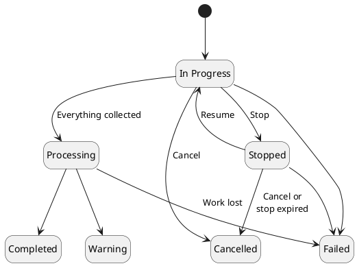

# Discovery

One of the most important tasks in managing the PKI infrastructure is to know where certificates and keys are deployed and what their state is. `Discovery` finds them in various sources and brings them into the inventory.

`Discovery` works with the help of a `Connector` that implements the `Discovery Provider`. The `Core` implements the logic of the discovery and of processing its results; the `Connector` implements the search in a specific technology.

:::info
The `Connector` implementing the `Discovery Provider` has its own `Attributes` for the inputs related to the discovery process.
:::

## Discovery Provider v1 and v2

The platform runs discoveries against two generations of the `Discovery Provider`:

| | [v1](../../connectors/provider-interfaces/discovery-provider.md) | [v2](../../connectors/provider-interfaces/discovery-provider-v2.md) |
|---|---|---|
| Connector | Legacy connector with the `Discovery Provider` function group | Connector exposing the `discovery` interface at version `v2` |
| Configured by | `Kind` and its `Attributes` | The resources to discover, run `Attributes` and `Attributes` per resource |
| Discovers | Certificates | Certificates and keys, one or more per run |
| Results | Collected once the connector has finished | Collected while the run is in progress |
| Progress | — | Reported by the connector while the run is in progress |
| Stop, resume, cancel | — | Supported; stop and resume only where the connector supports them |
| Run messages | — | Structured log of what went wrong, see [Run messages](#run-messages) |

A discovery is bound to one generation when it is created and keeps it for its whole life. Discoveries of both generations are listed, opened and deleted the same way, and each one shows which interface it ran through.

A discovery runs through v2 when its `Connector` exposes a `discovery` interface, and through v1 otherwise. A `Connector` exposing more than one `discovery` interface needs the discovery to say which one it uses. The same connector service can serve both generations; it is then registered twice, once for each.

## Discovery process

The following steps explain the process of `Discovery`:

1. `Client` selects the `Connector` that will perform the discovery
2. For a v2 `Connector`, `Client` selects the resources to discover, certificates, keys or both. For a v1 `Connector`, `Client` selects the `Kind`
3. `Client` gets the list of `Attributes` for the selection and provides their values
4. `Client` optionally assigns triggers, and creates the `Discovery`, either to run now or as a scheduled job

For a v1 discovery, `Core` forwards the `Attributes` to the `Connector`, checks the `Connector` for the status of the discovery, and collects all certificates when it has finished.

For a v2 discovery, `Core` starts the run at the `Connector` and polls it for status. It collects the discovered items while the run is in progress, in the order the `Connector` numbered them, and keeps them staged until the `Connector` has finished. The discovery shows the progress the `Connector` reports.

Afterwards, the discovery is switched to the `Processing` state, in which `Core` imports what was found:

- **Certificates.** A newly discovered certificate is added to the certificate inventory, unless an ignore trigger matches it. A certificate already in the inventory gets the discovery's metadata.
- **Keys.** A key with a public part is added to the key inventory, or found there when it is already known. See [Discovered keys](#discovered-keys).

Where the `Connector` found each item, such as a host and port, is kept on the certificate or key as metadata, with the discovery as its source.

### Triggers

Triggers assigned to a discovery are evaluated during processing, on the newly discovered certificates, for the **Certificate discovered** event. Platform-level triggers for the same event are evaluated after them. A certificate that was already in the inventory is not evaluated, and keys are never evaluated against triggers.

Triggers are evaluated **once per unique certificate**, not once per place it was found. The discovered certificates are grouped by their content, and both ignore triggers and action triggers are evaluated once for each group, against one of its rows. A certificate found on 10 hosts is therefore evaluated once, produces one entry per trigger in the [Event Viewer](../core-components/workflow/event-viewer.md), and the other 9 rows carry no trigger history of their own.

- When an ignore trigger matches, the certificate is not added to the inventory. Its rows count as processed, with no reason and no inventory object.
- For any other matched trigger, its actions are performed on the certificate the group was imported as.

### Discovered keys

A v2 discovery that targets keys imports the keys the `Connector` finds into the [key inventory](key-inventory.md#discovered-keys). A discovered key has no token: the platform holds at most its public part, and only a key whose public part is in SubjectPublicKeyInfo form is added to the inventory. A private, secret or split key, or a public part in another form, stays listed on the discovery's items as not imported, with the reason on its item.

- **Reasons are warnings.** Each processing batch that refuses keys files a `keyImportFailed` warning in the run messages, counting the keys, and the items listing says which keys and why. A discovery with any refused key ends with `Warning`, even when the key, such as a private key, was correctly listed rather than imported.
- **Permission.** Keys are imported as the user who started the discovery, who needs the `create` permission on `keys`. Without it, the keys are not imported and the attempt is retried: each attempt files an informational `batchProcessingFailed` message saying the user may not be allowed to create keys. When the retries run out, the remaining keys are marked "Not imported: processing stopped before this key could be imported." and the discovery ends with `Warning`.

## Operations

The `Discovery` allows you to perform the following operations:

| Operation | Description |
|-----------|-------------|
| Create | Create a new discovery with a `Connector` that implements the `Discovery Provider`. A v2 discovery created through the API is started at its `Connector` before the request returns, so a configuration the `Connector` refuses is refused to the caller with the `Connector`'s answer. |
| Schedule | Create a scheduled job that creates and runs the discovery on a cron expression, see [Scheduler](../architecture/scheduler.md#discovery-jobs). |
| List | List the discoveries started through the platform, with their `Connector`, the `Kind` of a v1 discovery, and the interface version. |
| Details | Details of the discovery: its status, the resources it targeted, its progress and counts, its metadata, and its `Attributes`. |
| List items | Every item the discovery staged, of every resource, see [Items](#items). |
| List messages | The run messages of a v2 discovery, see [Run messages](#run-messages). |
| Stop | Stop a v2 discovery that is in progress, keeping everything already collected and the checkpoint the `Connector` needs to resume it. Available only when the `Connector` declared the run stoppable. |
| Resume | Resume a stopped v2 discovery from its checkpoint. |
| Cancel | Cancel a v2 discovery that is in progress or stopped. Cancelling tells the `Connector` to stop and discards the run's work: whatever it has collected stays staged but is never imported into the inventory, and no triggers run on it. It cannot be undone. |
| Delete | Remove the discovery and the items it staged. Certificates and keys it imported stay in the inventory. |

Stop, resume and cancel need the `stop`, `resume` and `cancel` permissions on `discoveries`. Whether an operation is available depends on the status of the discovery:

| Operation | In Progress | Stopped | Processing | Completed, Warning, Failed, Cancelled |
|-----------|-------------|---------|------------|---------------------------------------|
| Stop      | Yes, when the run is stoppable | — | — | — |
| Resume    | — | Yes | — | — |
| Cancel    | Yes | Yes | — | — |
| Delete    | v1 only | — | v1 only | Yes |

A v2 discovery that has not ended cannot be deleted: cancel it first, or, once it is processing and can no longer be cancelled, wait for it to end. A v1 discovery can be deleted at any time, and the platform also asks its `Connector` to remove it. Stop, resume and cancel are not available for v1 discoveries.

## Discovery details

Besides its name, status, `Connector`, `Attributes` and metadata, the details of a discovery carry:

| Field | Description |
|-------|-------------|
| `resources` | The resources the discovery targets. A v1 discovery shows `certificates` |
| `connectorInterface` | The `discovery` interface the discovery runs through, with its version and feature flags. Absent for a v1 discovery |
| `stoppable` | Whether the discovery can be stopped. Always `false` for a v1 discovery |
| `progress` | The progress the `Connector` last reported: targets processed, in total, empty and failed, the phase, and per resource the items produced, an estimated total and the phase, with the time it was reported. Targets are described under [Progress and run metadata](../../connectors/provider-interfaces/discovery-provider-v2.md#progress-and-run-metadata) |
| `runMessageCount` | The number of entries in the [run messages](#run-messages). For a v1 discovery, `0` unless its metadata could not be stored |
| `itemsDiscovered` | The highest item sequence collected from the `Connector` so far. Absent for a v1 discovery |
| `itemsNewlyDiscovered`, `itemsProcessed`, `itemsFailed` | How many of the staged items were new to the inventory, have been processed, and carry a reason |
| `connectorStatus` | The status of the run as the `Connector` last reported it |

## Discovery status

| Status      | Description |
|-------------|-------------|
| In Progress | The `Connector` is discovering. For a v2 discovery, the platform collects items while it does |
| Stopped     | The v2 discovery was stopped. It can be resumed or cancelled |
| Processing  | The `Connector` has finished, and the platform is importing what it found |
| Completed   | The discovery has finished, and everything it found was processed without a problem |
| Warning     | The discovery has finished, but some items were not imported, or it recorded a problem. Its message, run messages and items say what |
| Failed      | The discovery could not be finished: the `Connector` failed or no longer knows the run, or the platform could not drive it. Items it collected are not processed |
| Cancelled   | The discovery was cancelled by a user, because it stayed stopped too long, because its `Connector` was force-deleted while the discovery was live, or because the `Connector` reported the run cancelled on its own. Items it collected are not processed |

### How a discovery ends

A v2 discovery that is processed to the end finishes as `Completed` unless one of these holds, in which case it finishes as `Warning`:

- an item carries a reason of its own: a key that was not imported, or a certificate that could not be processed,
- the run collected a run message of `warning` or `error` severity.

Targets the `Discovery Provider` could not read end up there too: when the provider has finished and its last progress counts failed targets, the platform files a `targetsFailed` warning for them, so the discovery ends `Warning`. Targets that held nothing to discover are a normal outcome and never downgrade it.

A problem the run recovered from does not downgrade it. A processing batch that fails and is then retried cleanly is recorded as an `info` message, so the discovery still ends `Completed`. A batch that keeps failing until its retries run out stops the processing, and the discovery ends `Warning` with the number of items that could not be imported.

A v1 discovery finishes as `Warning` when processing leaves a gap, for example certificates that could not be imported into the inventory, and its message states each gap with a count.

A v1 discovery whose metadata about the run could not be stored still finishes as `Completed` when nothing else went wrong, and its message ends with "Discovery metadata could not be stored." A v2 discovery records a `runMetadataNotRecorded` warning instead and finishes as `Warning`, as above.

### Time limits

A v1 discovery that is still in progress after `DISCOVERY_PROVIDER_MAX_WAIT_TIME_SECONDS` (6 hours by default) shows `Warning` while the platform keeps polling it; if the `Connector` then finishes, the discovery goes on as usual. At twice that time, 12 hours by default, the discovery ends `Failed`.

A v2 discovery has no time limit while its `Connector` keeps answering. Two conditions end it instead:

- **Work lost.** A v2 discovery that is in progress or processing, but that the platform no longer has any work scheduled for, ends `Failed` once it is older than `DISCOVERY_WORK_REAP_GRACE` (5 minutes by default). The platform then asks the `Connector` to cancel the run, on a best-effort basis.
- **Stop expired.** A v2 discovery that stays stopped for longer than `DISCOVERY_RUN_STOPPED_MAX_DURATION` (7 days by default) is cancelled. The `Connector` is asked to cancel the run on a best-effort basis, after the discovery is cancelled in the platform.

Every ending of a v2 discovery, including `Failed` and `Cancelled`, fires the **Discovery finished** event and notifies the user who started the discovery.

## Run messages

A v2 discovery keeps a log of the problems it ran into. The log is advisory: a discovery with messages has not necessarily failed. The detail of a discovery carries `runMessageCount`, and the messages themselves are listed by `GET /v1/discoveries/{uuid}/messages`.

Each entry describes one distinct problem:

| Field | Description |
|-------|-------------|
| `severity` | `info`, `warning` or `error` |
| `code` | What kind of problem it is, see below |
| `message` | The platform's description of the problem |
| `occurrences` | How many times it happened |
| `firstSeenAt`, `lastSeenAt` | When it happened first and last |

A problem that happens again is added to its existing entry rather than repeated: the count is in `occurrences`, never in the message. Entries are listed oldest first. A discovery keeps at most 20 entries of one code and 50 entries in all, keeping the oldest. Beyond 20, further problems of a code are counted on an entry of that code that reads "Further messages of this kind were not recorded."; beyond 50, all further problems are counted on one `messagesSuppressed` entry. The count on these entries is the number of occurrences that were not recorded.

A v1 discovery records one kind of entry only, `runMetadataNotRecorded`, when the `Connector`'s metadata about the run could not be stored. Its counted sentences stay in the discovery's message.

| Code | Severity | Meaning |
|------|----------|---------|
| `itemSequenceMissing` | warning | An item arrived without its sequence number and was skipped |
| `itemInvalid` | warning | An item broke the `Discovery Provider` contract and was skipped; the message names the rule |
| `certificatePayloadInvalid` | warning | An item declared as a certificate did not carry one |
| `certificateStagingFailed` | warning | A discovered certificate could not be staged |
| `inventoryGap` | warning | A discovered certificate could not be imported into the inventory |
| `keyAssociationGap` | warning | A certificate was imported without all of its public keys associated |
| `certificateNotProcessed` | warning | A discovered certificate could not be processed to a result |
| `bookkeepingIncomplete` | warning | Some per-certificate detail could not be recorded |
| `validationNotRequested` | warning | Validation of the discovered certificates could not be requested |
| `batchProcessingFailed` | info | A processing batch did not complete and will be tried again |
| `batchProcessingAbandoned` | warning | A processing batch failed after its items were already imported |
| `keyImportFailed` | warning | Discovered keys were not imported; the items listing says which, and why |
| `runMetadataNotRecorded` | warning | The `Connector`'s metadata about the run was not recorded: it was too large or malformed, or the platform could not store it |
| `targetsFailed` | warning | A target the `Discovery Provider` was asked to examine could not be read. `occurrences` is the number of failed targets in its last progress |
| `runEnded` | info, warning or error | How the discovery ended, with a severity that follows why it ended, see below |
| `messagesSuppressed` | worst of what it stands for | Further problems the discovery had no room to keep |

The `runEnded` entry takes its severity from the cause of the ending rather than from the final status alone, so an `error` entry always means the discovery failed:

| The discovery | Severity |
|---------------|----------|
| Completed | info |
| Ended with warnings | warning |
| Failed | error |
| Was cancelled by a user | info |
| Was cancelled because it stayed stopped too long, because its `Connector` was force-deleted while the discovery was live, or because the `Connector` reported the run cancelled on its own | warning |

## Items

`GET /v1/discoveries/{uuid}/items` lists everything a discovery staged, certificates included, in the order the `Connector` numbered it. It can be narrowed to one resource with `resource` (`certificates` or `keys`) and to newly discovered items with `newlyDiscovered`. For a v1 discovery it lists the same certificates as `GET /v1/discoveries/{uuid}/certificates`, numbered by the platform in the order they were staged.

| Field | Description |
|-------|-------------|
| `resource` | The resource of the item. Always present, even when its payload could not be read |
| `sequence` | The item's position in the run |
| `uniqueRef` | The `Connector`'s reference for the item |
| `payload` | What was found: the certificate or the key as the `Connector` reported it. Absent when it could not be read |
| `meta` | Where the `Connector` found the item |
| `discoveredAt` | When the item was found |
| `newlyDiscovered` | Whether the item was new to the inventory when it was staged |
| `processed`, `processedError` | Whether the item was processed, and the reason when it was not imported or could not be processed |
| `inventory` | The `uuid` and `name` of the inventory object the item became |

`inventory` names a certificate as soon as a certificate with that content exists in the inventory, whichever discovery or other path brought it there, and a key once it is imported. It is absent when the object was deleted later. For a key, an item with a `processedError` was not imported, a processed item without one was imported, and an item that is not processed yet is waiting.

The certificate-only listing, `GET /v1/discoveries/{uuid}/certificates`, stays available.

## API changes in 2.20.0

- `DiscoveryStatus` gains `stopped` and `cancelled`. A client that switches over the status values must handle them, or better, tolerate values it does not know.
- `SchedulerJobExecutionStatus` gains `cancelled`, which a scheduled job's last execution status and its execution history now report, and which the scheduled job finished event names as `Cancelled`. A client that switches over execution statuses must handle it, or tolerate values it does not know.
- `DiscoveryHistoryDetailDto` is renamed `DiscoveryDetailDto` and `DiscoveryHistoryDto` is renamed `DiscoveryListDto`, which breaks source compatibility for code using the generated types. The create request keeps the name `DiscoveryDto`, and no old name is reused for a different shape, so a stale reference fails at compile time. A v2 discovery carries no `kind` in either.
