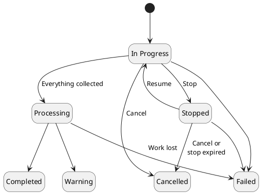

# Discovery

One of the most important tasks in managing the PKI infrastructure is to know where certificates and keys are deployed and what their state is. `Discovery` finds them in various sources and brings them into the inventory.

`Discovery` works with the help of a `Connector` that implements the `Discovery Provider`. The `Core` implements the logic of the discovery and of processing its results; the `Connector` implements the search in a specific technology.

:::info
The `Connector` implementing the `Discovery Provider` has its own `Attributes` for the inputs related to the discovery process.
:::

## Discovery Provider v1 and v2

The platform runs discoveries against two generations of the `Discovery Provider`:

| | [v1](../../connectors/provider-interfaces/discovery-provider.md) | [v2](../../connectors/provider-interfaces/discovery-provider-v2.md) |
|---|---|---|
| Connector | Legacy connector with the `Discovery Provider` function group | Connector exposing the `discovery` interface at version `v2` |
| Configured by | `Kind` and its `Attributes` | The resources to discover, run `Attributes` and `Attributes` per resource |
| Discovers | Certificates | Certificates and keys, one or more per run |
| Results | Collected once the connector has finished | Collected while the discovery is in progress |
| Progress | — | Reported by the connector while the discovery is in progress |
| Stop, resume, cancel | — | Supported; stop and resume only where the connector supports them |

A discovery is bound to one generation when it is created and keeps it for its whole life. Discoveries of both generations are listed, opened and deleted the same way, and each one shows which interface it ran through.

A discovery runs through v2 when its `Connector` exposes a `discovery` interface, and through v1 otherwise. A `Connector` exposing more than one `discovery` interface needs the discovery to say which one it uses. The same connector service can serve both generations; it is then registered twice, once for each.

## Discovery process

The following steps explain the process of `Discovery`:

1. `Client` selects the `Connector` that will perform the discovery
2. For a v2 `Connector`, `Client` selects the resources to discover, certificates, keys or both. For a v1 `Connector`, `Client` selects the `Kind`
3. `Client` gets the list of `Attributes` for the selection and provides their values
4. `Client` optionally assigns triggers, and creates the `Discovery`, either to run now or as a scheduled job

For a v1 discovery, `Core` forwards the `Attributes` to the `Connector`, checks the `Connector` for the status of the discovery, and collects all certificates when it has finished.

For a v2 discovery, `Core` starts the discovery at the `Connector`, follows its progress, and collects what it finds while it runs.

Afterwards, the discovery is switched to the `Processing` state, in which `Core` imports what was found:

- **Certificates.** A newly discovered certificate is added to the certificate inventory, unless an ignore trigger matches it. A certificate already in the inventory gets the discovery's metadata.
- **Keys.** A key is added to the key inventory, or found there when it is already known. See [Discovered keys](#discovered-keys).

Where the `Connector` found each certificate and key, such as a host and port, is kept on it as metadata, with the discovery as its source.

### Triggers

Triggers assigned to a discovery are evaluated during processing, on the newly discovered certificates, for the **Certificate discovered** event. Platform-level triggers for the same event are evaluated after them. A certificate that was already in the inventory is not evaluated, and keys are never evaluated against triggers.

Triggers are evaluated **once per unique certificate**, not once per place it was found. A certificate found on 10 hosts is evaluated once, and produces one entry per trigger in the [Event Viewer](../core-components/workflow/event-viewer.md).

- When an ignore trigger matches, the certificate is not added to the inventory.
- For any other matched trigger, its actions are performed on the certificate.

### Discovered keys

A v2 discovery that targets keys adds the keys it finds to the key inventory. Which keys are added, and what can be done with them, is described in [Discovered keys](key-inventory.md#discovered-keys).

A key that is found but not added, such as a private key, is still listed in the discovery's results with the reason, and the discovery ends `Warning`.

Keys are added as the user who started the discovery, who needs the `create` permission on `keys`. Without it, no key is added, and the discovery ends `Warning` once its retries run out; its messages name the missing permission as the likely cause.

## Operations

The `Discovery` allows you to perform the following operations:

| Operation | Description |
|-----------|-------------|
| Create | Create a new discovery with a `Connector` that implements the `Discovery Provider`. A configuration a v2 `Connector` refuses is refused when the discovery is created through the API, with the `Connector`'s answer. |
| Schedule | Create a scheduled job that creates and runs the discovery on a cron expression, see [Scheduler](../architecture/scheduler.md#discovery-jobs). |
| List | List the discoveries started through the platform. |
| Details | The status of the discovery, its progress, its results and its messages. |
| Stop | Stop a v2 discovery that is in progress, keeping everything already found, so it can be resumed later. Available only when the `Connector` can stop the discovery. |
| Resume | Resume a stopped v2 discovery where it stopped. |
| Cancel | Cancel a v2 discovery that is in progress or stopped. Whatever it has found is never imported into the inventory, and no triggers run on it. It cannot be undone. |
| Delete | Remove the discovery and its results. Certificates and keys it imported stay in the inventory. |

Stop, resume and cancel need the `stop`, `resume` and `cancel` permissions on `discoveries`. Whether an operation is available depends on the status of the discovery:

| Operation | In Progress | Stopped | Processing | Completed, Warning, Failed, Cancelled |
|-----------|-------------|---------|------------|---------------------------------------|
| Stop      | Yes, when the `Connector` can stop it | — | — | — |
| Resume    | — | Yes | — | — |
| Cancel    | Yes | Yes | — | — |
| Delete    | v1 only | — | v1 only | Yes |

A v2 discovery that has not ended cannot be deleted: cancel it first, or, once it is processing and can no longer be cancelled, wait for it to end. A v1 discovery can be deleted at any time, and the platform also asks its `Connector` to remove it. Stop, resume and cancel are not available for v1 discoveries.

## Discovery status

| Status      | Description |
|-------------|-------------|
| In Progress | The `Connector` is discovering. For a v2 discovery, the platform collects what it finds while it does |
| Stopped     | The v2 discovery was stopped. It can be resumed or cancelled |
| Processing  | The `Connector` has finished, and the platform is importing what it found |
| Completed   | The discovery has finished, and everything it found was processed without a problem |
| Warning     | The discovery has finished, but something was not imported, or it ran into a problem. Its message, messages and results say what |
| Failed      | The discovery could not be finished: the `Connector` failed or no longer knows the discovery, or the platform could not drive it. What it found is not imported |
| Cancelled   | The discovery was cancelled by a user, because it stayed stopped too long, because its `Connector` was force-deleted while the discovery was running, or because the `Connector` cancelled it on its own. What it found is not imported |

### How a discovery ends

A v2 discovery that is processed to the end finishes as `Completed`, unless something it found was not imported, or it recorded a warning in its [messages](#messages). It then finishes as `Warning`.

- **Failed targets.** When the `Connector` could not read part of what it was asked to examine, such as a host name that does not resolve, the discovery ends `Warning`. Targets that simply held nothing to discover are a normal outcome and do not.
- **Recovered problems.** A problem the discovery recovered from, such as an import that failed once and then succeeded, is recorded only for information and does not change the outcome.
- **Import that does not finish.** When importing keeps failing until its retries run out, the processing stops, and the discovery ends `Warning` with the number of items that could not be imported.

A v1 discovery finishes as `Warning` when processing leaves a gap, for example certificates that could not be imported into the inventory, and its message states each gap with a count. When only the `Connector`'s metadata about the discovery could not be stored, a v1 discovery still finishes as `Completed`, and its message ends with "Discovery metadata could not be stored."

### Time limits

A v1 discovery that is still in progress after `DISCOVERY_PROVIDER_MAX_WAIT_TIME_SECONDS` (6 hours by default) shows `Warning` while the platform keeps polling it; if the `Connector` then finishes, the discovery goes on as usual. At twice that time, 12 hours by default, the discovery ends `Failed`.

A v2 discovery has no time limit while its `Connector` keeps answering. Two conditions end it instead:

- **Work lost.** A v2 discovery that is in progress or processing, but that the platform no longer has any work scheduled for, ends `Failed` once it is older than `DISCOVERY_WORK_REAP_GRACE` (5 minutes by default). The platform then asks the `Connector` to cancel it.
- **Stop expired.** A v2 discovery that stays stopped for longer than `DISCOVERY_RUN_STOPPED_MAX_DURATION` (7 days by default) is cancelled, and the platform asks the `Connector` to cancel it too.

Every ending of a v2 discovery, including `Failed` and `Cancelled`, fires the **Discovery finished** event and notifies the user who started the discovery.

### Messages

A v2 discovery records the problems it ran into as messages, shown on its **Messages** tab. A problem that happens again is counted on its existing message rather than repeated. Messages are advisory: a message of `info` severity records something the discovery recovered from, while a `warning` makes the discovery end `Warning`. The last message says how the discovery ended.

A v1 discovery reports in its status message instead, and records a message only when the `Connector`'s metadata about the discovery could not be stored.

The kinds of message are listed in [`DiscoveryMessageCode`](https://github.com/OmniTrustILM/core/blob/main/src/main/java/com/otilm/core/model/discovery/DiscoveryMessageCode.java).

## Results

The results of a discovery list everything it found, certificates and keys, with where each was found, what it became in the inventory, and why it was not imported when it was not. They are shown on the discovery's **Results** tab and listed by `GET /v1/discoveries/{uuid}/items`; see [Get Discovery Results](../../quick-start/certificate-discovery/get-discovery-results.md).
