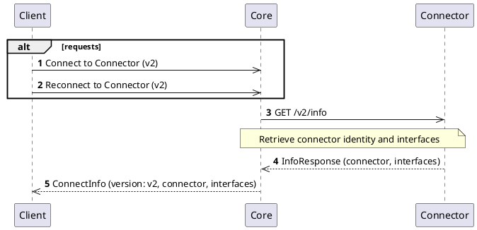
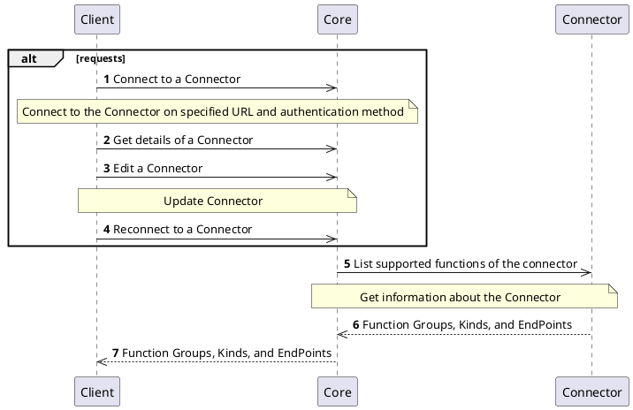
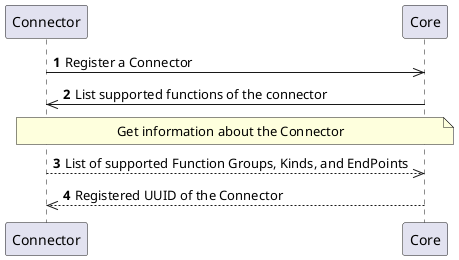

# Info Interface

## Overview

Each `Connector` has to implement the `Info` interface. This interface provides information about the list of supported functions and endpoints of the `Connector`.
The data is validated by the `Core` to check if the `Connector` is compliant with the definition of interfaces based on its function group.

## Connector NG

### How it works

In Connector NG, the `Info` interface is available at `GET /v2/info`. It provides structured information about the connector's identity, version, and the complete list of implemented interfaces — each with its own version and optional feature flags.

The `Core` uses this information during connect and reconnect operations to determine how to communicate with the connector and which provider interfaces are available.

### Endpoint

`GET /v2/info`

#### Response codes

| Response code | Description          |
|---------------|----------------------|
| 200           | See response         |
| 404           | Not found            |
| 500           | Internal Server Error |

### Response structure

The connector's `/v2/info` endpoint returns an `InfoResponse` with two top-level properties: `connector` and `interfaces`.

```json
{
  "connector": {
    "id": "ilm.example.connector",
    "name": "Example Connector",
    "version": "3.4.1",
    "description": "An example connector for demonstration purposes.",
    "metadata": {
      "author": "Example Author",
      "license": "Apache-2.0"
    }
  },
  "interfaces": [
    { "code": "info", "version": "v2", "features": [] },
    { "code": "health", "version": "v2", "features": [] },
    { "code": "metrics", "version": "v1", "features": ["openMetrics"] },
    { "code": "authority", "version": "v2", "features": [] }
  ]
}
```

#### `connector` object

| Field         | Type   | Required | Description                                                                        |
|---------------|--------|----------|------------------------------------------------------------------------------------|
| `id`          | string | yes      | Stable, unique identifier defined by the connector (e.g., `ilm.ejbca.ng`)  |
| `name`        | string | yes      | Human-readable name of the connector                                               |
| `version`     | string | yes      | Connector release version (e.g., `3.4.1`)                                         |
| `description` | string | no       | Human-readable description of the connector                                        |
| `metadata`    | object | no       | Free-form key-value pairs with additional information (author, license, etc.)      |

#### `interfaces` array

Each entry describes one implemented interface. The structure is `ConnectorInterfaceInfo`:

| Field      | Type            | Required | Description                                                                          |
|------------|-----------------|----------|--------------------------------------------------------------------------------------|
| `code`     | string          | yes      | Interface identifier — see [Interface codes](#interface-codes) below                 |
| `version`  | string          | yes      | Version of the interface implemented by this connector (e.g., `"v2"`)               |
| `features` | array of string | no       | Optional feature flags — see [Feature flags](#feature-flags) below                  |

The `version` is the letter `v` followed by the version number, such as `"v2"` or `"v3"`. `Core` compares it as an exact string against the versions it implements for the interface: a bare number such as `"2"` is accepted at registration, but `Core` refuses the interface as unsupported when it uses it.

### Interface codes

The `code` field must be one of the following values defined by the [`ConnectorInterface` enum](https://github.com/OmniTrustILM/interfaces/blob/main/src/main/java/com/otilm/api/model/client/connector/v2/ConnectorInterface.java):

| Code                   | Label              | Category   |
|------------------------|--------------------|------------|
| `info`                 | Info               | Common     |
| `health`               | Health             | Common     |
| `metrics`              | Metrics            | Common     |
| `attributes`           | Attributes         | Common     |
| `authority`            | Authority          | Functional |
| `discovery`            | Discovery          | Functional |
| `entity`               | Entity             | Functional |
| `compliance`           | Compliance         | Functional |
| `cryptography`         | Cryptography       | Functional |
| `notification`         | Notification       | Functional |
| `secret`               | Secret             | Functional |
| `signatureFormatting`  | Signature Formatting | Functional |
| `cadesFormatting`      | CAdES Formatting   | Functional |
| `jadesFormatting`      | JAdES Formatting   | Functional |
| `padesFormatting`      | PAdES Formatting   | Functional |
| `xadesFormatting`      | XAdES Formatting   | Functional |

### Feature flags

Feature flags are optional capability indicators that signal connector behaviour beyond what the API reference defines. The `features` field contains values from the [`FeatureFlag` enum](https://github.com/OmniTrustILM/interfaces/blob/main/src/main/java/com/otilm/api/model/client/connector/v2/FeatureFlag.java):

| Code                      | Behavior      | Applicable interfaces                                      | Prerequisite          | Description |
|---------------------------|---------------|------------------------------------------------------------|------------------------|-------------|
| `stateless`               | Informational | any                                                        |                        | A stateless connector does not require a persistence layer (e.g. database) |
| `openMetrics`             | Informational | `metrics`                                                  |                        | Metrics are exposed in OpenMetrics format |
| `asynchronous`            | Enforced      | `cryptography`                                             |                        | Supports asynchronous operations |
| `keyImport`               | Enforced      | `cryptography`                                             |                        | Supports importing key material supplied as a protected PKCS#8 envelope into the technology |
| `keyExport`               | Enforced      | `cryptography`                                             |                        | Supports exporting key material as a protected PKCS#8 envelope |
| `secretVersioning`        | Enforced      | `secret`                                                   |                        | Supports versioning of secrets, allowing history of secrets to be kept |
| `secretRotation`          | Enforced      | `secret`                                                   |                        | Supports triggering rotation of secrets |
| `contentSigning`          | Enforced      | `padesFormatting`, `xadesFormatting`, `cadesFormatting`, `jadesFormatting` |                        | Supports content signing workflows |
| `levelTimestamped`        | Enforced      | `padesFormatting`, `xadesFormatting`, `cadesFormatting`, `jadesFormatting` | `contentSigning`       | Reaches the TIMESTAMPED level for the family interface by implementing the signature timestamp imprint and embed pair |
| `levelLongTerm`           | Enforced      | `padesFormatting`, `xadesFormatting`, `cadesFormatting`, `jadesFormatting` | `levelTimestamped`     | Reaches the LONG_TERM level for the family interface by implementing `extendToLevel` with its own fetching |
| `levelArchival`           | Enforced      | `padesFormatting`, `xadesFormatting`, `cadesFormatting`, `jadesFormatting` | `levelLongTerm`        | Reaches the ARCHIVAL level for the family interface by implementing the archive timestamp imprint and embed pair |
| `timestamping`            | Enforced      | `signatureFormatting`                                      |                        | Supports timestamping of signatures |
| `certificateRegistration` | Enforced      | `authority`                                                 |                        | Supports pre-registering a certificate identity at the upstream CA before a CSR exists |
| `certificateStatusPolling` | Enforced     | `authority`                                                 |                        | Supports polling for asynchronous operation completion |
| `certificateRequestStructured` | Enforced | `authority`                                                 |                        | Accepts the structured `requestContent` model on register, issue, and renew |
| `certificateIdentityOverride` | Enforced | `authority`                                                |                        | Applies an authoritative platform-supplied identity to a forwarded CSR |
| `discoveryStopResume`     | Enforced      | `discovery`                                                |                        | Supports pausing a running discovery with a resumable checkpoint and resuming it later |

A flag is either informational or enforced. `Core` handles an informational flag's behavior whether or not the connector lists it; `stateless` and `openMetrics` are informational. An enforced flag is opt-in: the capability counts as supported only when the connector lists the flag on that interface, and `Core` never invokes it otherwise. The other flags in this table are enforced. The signature-level flags form a prerequisite ladder: `levelTimestamped` requires `contentSigning`, `levelLongTerm` requires `levelTimestamped`, and `levelArchival` requires `levelLongTerm`.

### Processes

#### Connect and reconnect (NG)

The `Core` uses the `/v2/connectors/connect` and `/v2/connectors/{uuid}/reconnect` endpoints to register or refresh a Connector NG. These v2 endpoints work for both legacy and NG connectors.



**For legacy connectors (`version: "v1"`):**
The response contains `functionGroups` and `kinds` instead of `connector` and `interfaces`.

### Specification and example

You can find specification and information about the Connector NG `Info` interface on the following locations:
- [Core Connector API v2](/api/core-connector#tag/connector-management-v2) — `getInfoV2`, `connectV2`, `reconnectV2`
- [Secret Provider API](/api/connector-secret-provider) — connector-side `GET /v2/info` schema

---

## Legacy Connectors

### How it works

The `Info` interface is used during the `Connector` registration and reconnecting to update the information if necessary.

### Processes

#### Client operations

The `Client` with proper permissions can manage the `Connectors` and invoke API that works with the `Info` interface of the `Connector`.
The following diagrams represents the requests and communication flow.



#### Connector self-registration

The `Connector` is allowed to self-register in the platform. In this case the information about the `Connector` is stored and waiting for approval by the user or administrator.
The registration of the `Connector` may be executed by any external entity.



### Specification and example

You can find specification and information about the legacy `Info` interface on the following locations:
- [Core Connector API](/api/core-connector)
- Connector API specifications, see for example [Authority Provider](/api/connector-authority-provider-v2)
