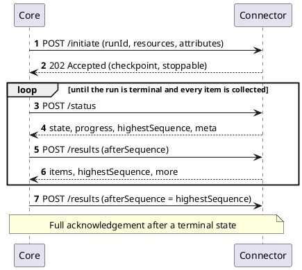

# Discovery Provider v2

## Overview

Discovery Provider v2 is the interface between `Core` and a connector that finds certificates and keys in a technology, such as a network, a certificate store or a key management service. It differs from the [v1 interface](./discovery-provider.md) as follows:

- **Several resources per run.** A run targets one or more resource types, certificates or keys, chosen when the discovery is created from those the connector supports.
- **Stateless.** Every request carries the run's identity, its resources, its attributes and the connector's checkpoint, so the connector can rebuild a run from any request, including after a restart.
- **Incremental results.** `Core` collects items while the run is still scanning, in sequence, and acknowledges them as it goes. The connector does not have to hold a run's whole result until it ends.
- **Stop, resume and cancel.** A run can be stopped with a checkpoint and resumed later, or cancelled.

How the platform presents discovery runs, their statuses and their results is described on the [Discovery](../../concept-design/modules/discovery.md) page. This page describes the connector interface itself.

## Relationship to v1

`Core` serves both contracts side by side:

| Generation | Wire | Registration | Resources | Results |
|------------|------|--------------|-----------|---------|
| [v1](./discovery-provider.md) | `/v1/discoveryProvider/…` | Legacy connector with the `Discovery Provider` function group | Certificates | Collected in pages once the connector reports the discovery finished |
| **v2** | `/v2/discoveryProvider/…` | Connector reporting the `discovery` interface at version `v2` through its [Info interface](../common-interfaces/info-interface.md) | Certificates, keys | Drained in sequence while the run is in progress |

A discovery is bound to one contract when it is created and keeps it for its whole life. A connector that exposes no `discovery` interface runs v1 discoveries. A connector that exposes one `discovery` interface runs v2 discoveries through it, and one that exposes more than one needs the discovery to name the interface it uses. `Core` drives version `v2` only; it refuses to create a discovery on any other version.

The same connector service can implement both contracts. It is then registered twice, once as a legacy connector and once as a v2 connector, and each registration runs the discoveries created against it.

## How it works

### Run scope

`Core` mints a `runId` for each run and never reuses it. Every operation request carries the run's whole scope: its `runId`, the resources it targets, its run-level and per-resource attributes, and, after initiate, the connector's `checkpoint`. The exact shape is [`DiscoveryV2ScopedRequestDto`](https://github.com/OmniTrustILM/interfaces/blob/main/src/main/java/com/otilm/api/model/connector/discovery/v2/DiscoveryV2ScopedRequestDto.java).

The `checkpoint` is the connector's own description of where the run stands. `Core` never interprets it. It stores the checkpoint that the initiate, stop and resume responses return, keeps the stored one when a response leaves it out, and replays it on every later request for the run. A checkpoint larger than 64 KB serialized cannot be replayed, so the run ends `Failed`, and `Core` cancels it at the connector.

### Resources and attributes

Three metadata endpoints under `/v2/discoveryProvider` describe what the connector discovers and how it is configured:

| Endpoint | Returns |
|----------|---------|
| `GET /resources` | The resource types the connector discovers. Each entry carries the resource type only. |
| `GET /attributes` | The attribute schema of a run, independent of the resources it targets. |
| `GET /{resource}/attributes` | The attribute schema of one resource type, for example `GET /certificates/attributes`. |

`Core` asks for the resource types when a discovery is created, and refuses one that targets a resource type the connector does not list. Whether a run can be stopped is not declared here; it is declared per run, in the initiate response.

### Run lifecycle

All operations are `POST` requests under `/v2/discoveryProvider/discoveries`:

| Operation | Path | Success | Purpose |
|-----------|------|---------|---------|
| Initiate | `/initiate` | `202 Accepted` | Start a run. Returns the first `checkpoint` and, optionally, `stoppable`. |
| Status | `/status` | `200 OK` | Report the run's state, progress, highest sequence and run metadata. |
| Results | `/results` | `200 OK` | Return one page of discovered items, and acknowledge the items before it. |
| Stop | `/stop` | `200 OK` | Stop scanning. Returns the `checkpoint` to resume from. |
| Resume | `/resume` | `202 Accepted` | Continue a stopped run from the replayed `checkpoint`. |
| Cancel | `/cancel` | `204 No Content` | End the run for good. |

There is no delete operation. Deleting a discovery in the platform removes `Core`'s record only and never calls a v2 connector.



The status response reports the run's `state`: `running`, `stopped`, `completed`, `failed` or `cancelled`.

`Core` polls the status and drains the results on its own schedule. A run in progress gets a status poll, and a drain that finds nothing new, about once a minute; a drain that returns `more` is followed at once by the next page, and a stopped run is polled every 5 minutes. When the connector reports `completed` and every item up to the highest sequence has been collected, `Core` moves the run to processing and sends the full acknowledgement described below. A connector that reports `failed` or `cancelled` ends the run with that status.

### Sequencing and acknowledgement

Every item carries a `sequence`, a number that is unique within the run. Sequences start at 1, are dense with no gaps, and continue across a stop and resume; the connector never restarts numbering for a run. The status and results responses both report `highestSequence`, the highest sequence the run has assigned so far, across the whole run rather than one page.

`Core` drains with a cursor:

- **`afterSequence`** is the highest sequence `Core` has stored. The response returns items above it, in order.
- **`maxItems`** and **`maxBytes`** bound the page. `Core` asks for 500 items and 5 MB by default; `maxBytes` may not exceed 10 MB. When a limit is omitted, the connector applies a bound of its own.
- The response carries the `items`, an explicit empty list when there are none, the `highestSequence`, and `more`, which tells whether further items are ready beyond the page.

Submitting an `afterSequence` acknowledges every item at or below it, and the connector may discard them once it has answered. Items above the cursor are served again if `Core` repeats the cursor, for example after a failed request. `Core` deduplicates items by their `uniqueRef`, so serving an item twice is harmless.

A drain with `afterSequence` equal to `highestSequence`, made after the run has reached a terminal state, is the **full acknowledgement**: the connector may then discard everything it holds for the run. Until the full acknowledgement arrives, it must keep the run's terminal state for at least 24 hours.

If the connector can rebuild a run but no longer holds the items a drain asks for, it answers `404` rather than serving a later page. `Core` takes the highest sequence of a page as its new cursor, so a page served across a gap loses every item in the gap.

### Progress and run metadata

The status response can carry two further statements about the run:

- **`progress`** — how far the run has got, counted in targets and in items per resource, as described below. The platform stamps `updatedAt` itself and ignores a value the connector sends.
- **`meta`** — the connector's metadata about the run, as metadata attributes, shown on the discovery. When `meta` is absent, `Core` keeps the metadata it holds; when it is present, it replaces that metadata whole; an empty list clears it. `meta` larger than 64 KB serialized, or malformed, is dropped with a `runMetadataNotRecorded` run message. The run goes on, but the warning makes it end `Warning`. The counts `progress` has fields for belong there, not in `meta`; `meta` can say what `progress` has no field for, such as why targets failed.

`progress` counts the connector's work in targets. A target is one unit of the connector's work that a person would recognize, such as an address and port, a CA, a CA and certificate template, a secrets mount or a report. One target can yield many items or none.

Every processed target ends one way: it yielded items, it held nothing to discover, or the connector expected to read it and could not, because access was refused, a source it was configured to read was unreachable, or it could not read the answer. `targetsProcessed` counts all of them; `targetsEmpty` and `targetsFailed` count the two kinds of target that yielded nothing, within `targetsProcessed` rather than in addition to it, and never the same target twice. `targetsTotal` is how many targets the run will attempt, exact or estimated; leave it out when the connector cannot know it, and clients then show no percentage. `phase` is a free-text label for what the connector is doing, and `byResource` reports per resource the items produced, an estimated total and a phase. The fields are defined in [`DiscoveryProgressDto`](https://github.com/OmniTrustILM/interfaces/blob/main/src/main/java/com/otilm/api/model/connector/discovery/v2/DiscoveryProgressDto.java).

An empty target is a normal outcome, not a failure, even when the connector had to try it to learn that it was empty, as a scan of an address range does. Leave out a counter you cannot keep: `targetsProcessed` when the connector cannot count its work, `targetsEmpty` when it does not tell empty targets apart.

A connector whose unit of work would only be a page of search results leaves all the target counters out, because a count of pages means nothing to the person watching the run, and reports `byResource` and `phase` instead. When such a run targets one resource and reports its `totalEstimate`, the platform shows the run's progress in items against that estimate.

Failed targets do not make the run fail, but part of what it was asked to examine went unexamined, and the platform reports that. When the connector has finished the run and its last `progress` reports `targetsFailed` above zero, `Core` files a `targetsFailed` warning counting the failed targets, and the discovery ends `Warning`. Empty targets never produce a run message.

### Stop, resume and cancel

Stopping and resuming are an optional capability. A connector that supports them lists the [`discoveryStopResume`](../common-interfaces/info-interface.md#feature-flags) feature flag on its `discovery` interface. The flag is enforced: without it, the platform never sends a stop or a resume.

Stoppability is decided per run, not per resource type. The initiate response may carry `stoppable`, which narrows the flag for that run:

- `false` — this run cannot be stopped, even though the connector can stop others.
- `true` — this run can be stopped. Without the flag it is ignored; `stoppable` never widens the flag.
- Absent — the flag alone decides.

Every resume response replaces the value. A resume response without `stoppable` reverts the run to the flag alone.

| Operation | Behavior |
|-----------|----------|
| Stop | The connector stops scanning and returns a best-effort `checkpoint` that preserves the sequence counter. Items found but not yet drained must stay drainable; `Core` collects them once the run is resumed. A run that has already finished, or that cannot be checkpointed, is refused with `422` [`OPERATION_PAST_POINT_OF_NO_RETURN`](/problems/connector/OPERATION_PAST_POINT_OF_NO_RETURN). |
| Resume | `Core` replays the stored `checkpoint`, and the connector continues the run from it, numbering on from the last sequence. The response carries the possibly updated `checkpoint` and `stoppable`. A checkpoint that can no longer be continued is answered with `410` [`CHECKPOINT_LOST`](/problems/connector/discovery/CHECKPOINT_LOST). |
| Cancel | The connector ends the run and discards its state once it has answered. A run the connector does not track counts as already cancelled. A run past the point of no return is refused with `422` [`OPERATION_PAST_POINT_OF_NO_RETURN`](/problems/connector/OPERATION_PAST_POINT_OF_NO_RETURN). |

A run that stays stopped too long is cancelled by the platform, which then sends the connector a cancel on a best-effort basis.

### Errors

The connector answers errors as `application/problem+json`, following [Error Handling](../error-handling.md). These codes carry a meaning of their own in the run lifecycle:

| Code | Status | Operations | What `Core` does |
|------|--------|------------|------------------|
| [`VALIDATION_FAILED`](/problems/common/VALIDATION_FAILED) | `422` | All | On initiate, a discovery created through the API is discarded and its creation refused with the connector's answer; a scheduled one ends `Failed`. |
| [`OPERATION_NOT_TRACKED`](/problems/connector/OPERATION_NOT_TRACKED) | `404` | Status, results, stop, resume, cancel | The run ends `Failed` (after a refused stop, at the next status poll; after a resume, as *checkpoint lost*). On cancel, the run ends `Cancelled`. |
| [`CHECKPOINT_LOST`](/problems/connector/discovery/CHECKPOINT_LOST) | `410` | Resume | The run ends `Failed` with the message *checkpoint lost*. |
| [`OPERATION_PAST_POINT_OF_NO_RETURN`](/problems/connector/OPERATION_PAST_POINT_OF_NO_RETURN) | `422` | Stop, cancel | The request is refused with the same status, and the run goes on unchanged. |

Answer `404` only for a `runId` you cannot rebuild from the request: it ends the run at once, and a stopped run may wait days for its resume. `410` is different from `404`: the run is known, but its checkpoint cannot be continued.

## Items

A discovered item carries its `sequence`, its `uniqueRef`, which is the connector's natural key for the item and lets `Core` deduplicate it across drains and retries, the `payload` that says what was found, and optionally `discoveredAt` and `meta`. `meta` says where the item was found, such as a host, port or path, as metadata attributes, and `Core` keeps it on the inventory object as discovery metadata; location belongs there, never in the payload. The item is defined in [`DiscoveredItemDto`](https://github.com/OmniTrustILM/interfaces/blob/main/src/main/java/com/otilm/api/model/connector/discovery/v2/DiscoveredItemDto.java).

The `payload` is polymorphic: its `resource` property names the resource type, and the other properties depend on it. In the OpenAPI document it is the `oneOf` schema `DiscoveredItemPayload` with `resource` as its discriminator. A connector written in Java gets this from the `interfaces` library; a connector written in another language must write `resource` into every payload itself, because the item carries no resource field of its own and `Core` reads the type from the payload alone.

A certificate payload has `resource` set to `certificates` and carries the Base64-encoded DER certificate, see [`DiscoveredCertificateDto`](https://github.com/OmniTrustILM/interfaces/blob/main/src/main/java/com/otilm/api/model/connector/discovery/v2/DiscoveredCertificateDto.java). A key payload has `resource` set to `keys` and carries the key's type and algorithm, and optionally its length, fingerprint and public key, see [`DiscoveredKeyDto`](https://github.com/OmniTrustILM/interfaces/blob/main/src/main/java/com/otilm/api/model/connector/discovery/v2/DiscoveredKeyDto.java).

```json
{ "sequence": 1, "uniqueRef": "10.0.0.5:443:0", "payload": { "resource": "certificates", "certificateData": "MIIF..." } }
{ "sequence": 2, "uniqueRef": "kms/keys/7f3a", "payload": { "resource": "keys", "type": "Public", "algorithm": "RSA", "length": 2048, "publicKeyFormat": "SubjectPublicKeyInfo", "publicKey": "MIIBIjAN..." } }
```

A key payload never carries private material. For a `Private`, `Secret` or `Split` key, `publicKey` and `publicKeyFormat` must be absent, and `publicKeyFormat` is never `PrivateKeyInfo` or `EncryptedPrivateKeyInfo`. `Core` checks every item against the contract and skips one that breaks it, with a warning in the discovery's messages. It computes a key's fingerprint, algorithm and size from the public key itself rather than taking the connector's values. Which keys are added to the inventory is described in [Discovered keys](../../concept-design/modules/key-inventory.md#discovered-keys).

## For connector developers

A v2 connector implements the metadata endpoints (`/resources`, `/attributes`, `/{resource}/attributes`) and the run operations `initiate`, `status`, `results` and `cancel`. A connector that lists `discoveryStopResume` also implements `stop` and `resume`, and answers `stop` and `resume` for every run it declares stoppable.

When implementing the lifecycle:

- **Validate the whole initiate request.** Refuse it with `422` when any requested resource type or attribute is not supported, rather than silently scanning fewer resource types. Answer a repeated initiate with the same `runId` and an identical request with another `202`.
- **Rebuild instead of forgetting.** Every request carries what is needed to rebuild a run, so keep a run's state out of the process only if it can be rebuilt; answer `404` only when it cannot.
- **Keep a run after an ordinary drain.** The drain that collects the last items already has the shape of the full acknowledgement, and `Core` sends it before it records that the run has been fully collected. Treat it as an ordinary drain: release the run's working resources if you like, but keep answering `status` and `results` for the run until its retention ends. A run dropped at that point makes the next request answer `404`, which ends a completed discovery `Failed`.
- **Refuse a stop on a finished run** with `422` `OPERATION_PAST_POINT_OF_NO_RETURN`. Accepting it makes `Core` record the run as stopped and stop draining it, and a later `completed` status does not restart the drain, so the run never ends.
- **Expect concurrent requests for one run.** `Core` checks whether an operation is legal before it calls the connector, so two resumes, or a resume and a stop, can reach the connector at the same time. Serialize initiate, stop and resume per run.
- **Size result buffers against the polling interval.** After an empty drain, the next one waits out `Core`'s polling interval, which is tens of seconds by default and configurable by the operator.

## Specification

Discovery Provider v2 implements the [Common Interfaces](../common-interfaces/overview.md) and these interfaces of its own:

- Discovery Metadata v2
- Discovery Operations v2
