# PKCS#11 Cryptography Provider

The **PKCS#11 Cryptography Provider** connects the platform to hardware security modules (HSMs) through their PKCS#11 interface, so that keys are generated and used on the HSM while the platform manages them. One connector can serve several HSMs, including HSMs from different vendors.

The connector implements the [Cryptography Provider v2](../../connectors/provider-interfaces/cryptography-provider-v2.md) interface and supports the following operations:

| Operation                 | Supported                                                                                                                                         |
|---------------------------|---------------------------------------------------------------------------------------------------------------------------------------------------|
| Key pair generation       | RSA (2048, 3072 and 4096 bits), ECDSA (P-256, P-384 and P-521), ML-DSA (ML-DSA-44, ML-DSA-65 and ML-DSA-87), SLH-DSA (SHA2 at security categories 1, 3 and 5, for small signatures or fast signing) |
| Signing and verification  | RSA PKCS#1 v1.5, RSA-PSS and ECDSA with SHA-256, SHA-384 or SHA-512, ML-DSA, SLH-DSA                                                                |
| Encryption and decryption | RSA only: PKCS#1 v1.5, and OAEP with SHA-1, SHA-256, SHA-384 or SHA-512                                                                           |
| Random data               | Up to 1 MiB per request                                                                                                                           |
| Key destruction           | Removes the key from the HSM                                                                                                                      |

The connector offers only what the HSM reports: an algorithm, key size or signature scheme appears when the token provides the mechanisms it needs, so the choices depend on the HSM and its firmware. Keys cannot be imported or exported through the platform, and every operation runs synchronously.

## How it works

```plantuml
@startuml
skinparam ArrowColor #1573B5
skinparam ComponentBorderColor #1573B5
skinparam RectangleBorderColor #1573B5
skinparam PackageBorderColor #1573B5
skinparam NoteBackgroundColor #F7F7F7
skinparam defaultFontName sans-serif
skinparam componentStyle rectangle
skinparam shadowing false
skinparam nodesep 70

component "Core" as Core #E1F5E0

package "PKCS#11 connector deployment (one Kubernetes pod)" as Pod {
  component "PKCS#11\nconnector" as Connector #E1F5E0

  rectangle "Utimaco sidecar" as UtimacoSidecar #F7F7F7 {
    component "PKCS#11 proxy" as UtimacoProxy #E1F5E0
    component "Utimaco PKCS#11\nlibrary" as UtimacoLibrary #F7F7F7
  }

  rectangle "Securosys sidecar" as SecurosysSidecar #F7F7F7 {
    component "PKCS#11 proxy" as SecurosysProxy #E1F5E0
    component "Securosys PKCS#11\nlibrary" as SecurosysLibrary #F7F7F7
  }

  rectangle "Entrust sidecar" as EntrustSidecar #F7F7F7 {
    component "PKCS#11 proxy" as EntrustProxy #E1F5E0
    component "Entrust PKCS#11\nlibrary" as EntrustLibrary #F7F7F7
  }

  Connector "<size:19> </size>\nUtimaco Config Profile&#160;&#160;&#160;&#160;&#160;&#160;&#160;&#160;&#160;&#160;&#160;&#160;&#160;&#160;&#160;&#160;" -[#1573B5]-> UtimacoProxy
  Connector -[#1573B5]-> SecurosysProxy : Securosys Config Profile
  Connector -[#1573B5]-> EntrustProxy : Entrust Config Profile

  UtimacoProxy -[#1573B5]-> UtimacoLibrary
  SecurosysProxy -[#1573B5]-> SecurosysLibrary
  EntrustProxy -[#1573B5]-> EntrustLibrary
}

component "Utimaco\nHSM" as UtimacoHSM #F7F7F7
component "Securosys\nHSM" as SecurosysHSM #F7F7F7
component "Entrust\nHSM" as EntrustHSM #F7F7F7

Core -[#1573B5]-> Connector : Cryptographic requests
UtimacoLibrary -[#1573B5]-> UtimacoHSM : Vendor connection
SecurosysLibrary -[#1573B5]-> SecurosysHSM : Vendor connection
EntrustLibrary -[#1573B5]-> EntrustHSM : Vendor connection
@enduml
```

The connector loads no PKCS#11 library itself. Each vendor's library runs with a PKCS#11 proxy in its own sidecar container, in the same pod as the connector, and only that sidecar connects to the vendor's HSM. Commercial libraries are licensed separately, so you build each vendor's sidecar image yourself; see [Deploy the PKCS#11 Cryptography Provider](../../installation-guide/deployment/pkcs11-cryptography-provider/deployment.md).

A **Config Profile** names one sidecar. Each `Token` in the platform selects a Config Profile and one token that the HSM behind it presents.

The connector is validated with the following HSMs:

| HSM                  | Notes                                                                            |
|----------------------|----------------------------------------------------------------------------------|
| SoftHSM              | A software token for evaluation and testing. Its sidecar image is published complete. |
| Utimaco CryptoServer | Standard and QuantumProtect firmware.                                            |
| Securosys Primus     | Primus HSMs and Securosys CloudHSM.                                               |
| Entrust nShield      | Network-attached HSMs. Keys are kept as wrapped key blobs on a persistent volume. |

## Prerequisites

Before you start, make sure that:

- The connector is deployed with the Config Profiles for your HSMs, and registered in the platform. See [Deploy the PKCS#11 Cryptography Provider](../../installation-guide/deployment/pkcs11-cryptography-provider/deployment.md).
- You know the user PIN of each HSM token that the platform will use.
- A [`Vault Profile`](../../concept-design/core-components/vault-profile.md) is available in the platform to store the PINs.

## Configuration in the platform

### Store the PIN

The user PIN of the token is supplied to the connector as a [`Secret`](../../concept-design/core-components/secret.md). Create a `Secret` of type `Generic` through a `Vault Profile`, with the PIN as its content.

The **User PIN** attribute of the `Token` lists only secrets of this type. The platform resolves the PIN for each request, and the connector does not store it.

### Create the `Token`

Create a [`Token`](../../concept-design/core-components/token.md) that uses the connector. The connector defines the following attributes:

| Attribute      | Required | Description                                                                                                                                   |
|----------------|----------|-----------------------------------------------------------------------------------------------------------------------------------------------|
| Config profile | Yes      | The Config Profile, and so the sidecar and HSM, that serves the token                                                                          |
| Token          | Yes      | One of the initialized tokens that the selected Config Profile reports. It is stored as a PKCS#11 URI, such as `pkcs11:token=my-token;serial=0123456789abcdef;slot-id=1` |
| User PIN       | Yes      | The `Generic` secret holding the user PIN of the token                                                                                         |

The status of the `Token` shows whether the connector reaches it: `Connected`, `Disconnected` when the sidecar or the token cannot be reached, `Warning` when the token answers but needs attention, such as a locked PIN, and `Unknown` when it cannot be determined, such as when the HSM has no free session. The status check sends no PIN, so a `Connected` token does not confirm the PIN; the first key operation does.

### Create the `Token Profile`

Create a [`Token Profile`](../../concept-design/core-components/token-profile.md) on the `Token`, with the key usages its keys may have, such as signing and verification for a signing key. For a token that supports ML-DSA, the connector adds one attribute:

| Attribute           | Required | Description                                                                                                                                                                                                                           |
|---------------------|----------|---------------------------------------------------------------------------------------------------------------------------------------------------------------------------------------------------------------------------------------|
| ML-DSA signing mode | No       | `pure`, the default, sends the whole message to the HSM. `external-mu`, offered when the token supports it, sends only a 64-byte digest of the message (μ, as defined by FIPS 204), so that messages above the input limit of the HSM can be signed. Both produce standard ML-DSA signatures. Keys of other algorithms ignore the setting |

### Create a test key

Create a [`Key`](../../concept-design/core-components/key.md) in the `Token Profile`. The connector defines the following attributes:

| Attribute                   | Required | Description                                                                                                                                                                                   |
|-----------------------------|----------|-----------------------------------------------------------------------------------------------------------------------------------------------------------------------------------------------|
| Key Label                   | No       | Label of both halves of the key pair on the HSM. Left empty, the label is the UUID of the key                                                                                                 |
| Cryptographic Key Algorithm | Yes      | `RSA`, `ECDSA`, `ML-DSA` or `SLH-DSA`, as far as the token supports them. The required parameters of the selected algorithm follow: **RSA Key Size**, **Named Curve**, or **NIST Security Category**, and for SLH-DSA also **Hash Function** and **Signature Generation Mode** |
| Sensitive                   | No       | Whether the value of the private key can never be read from the HSM in plaintext. Default: enabled                                                                                              |
| Extractable                 | No       | Whether the HSM lets the private key be exported, wrapped by another key. Default: disabled                                                                                                    |

**Sensitive** and **Extractable** apply to the private key and cannot be changed after the key is created.

A created key confirms the whole path: the connector reaches the HSM, the token accepts the PIN, and the HSM generates the selected algorithm. To test an operation, sign data with the key through the [Cryptographic Operations API](/api/core-cryptographic-operations).

If a step fails, see [Troubleshooting](../../installation-guide/deployment/pkcs11-cryptography-provider/troubleshooting.md).
