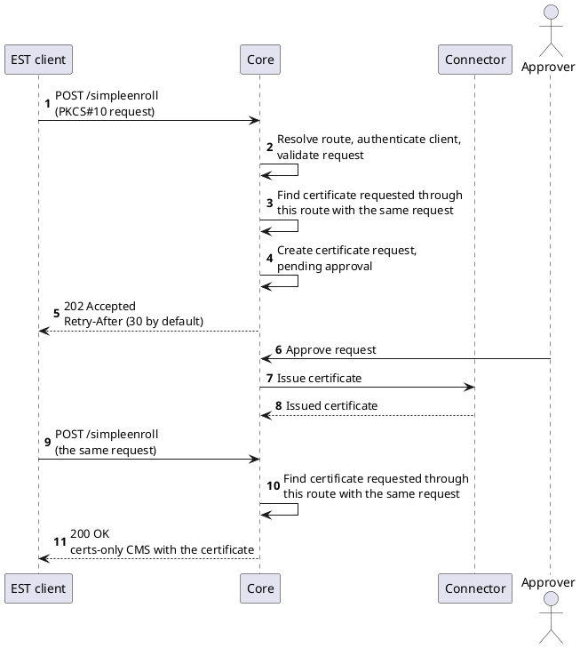

# Overview

Enrollment over Secure Transport (EST) lets devices, network equipment and registration authorities obtain and renew certificates over HTTPS. The client sends a PKCS#10 certification request and receives the issued certificate, without the message-level cryptography that SCEP and CMP add on top of the transport. TLS protects the exchange, and the client authenticates with HTTP Basic credentials or a TLS client certificate.

The platform implements an EST server according to [RFC 7030 - Enrollment over Secure Transport](https://datatracker.ietf.org/doc/html/rfc7030), with the CSR attributes of [RFC 9908](https://datatracker.ietf.org/doc/html/rfc9908) and the base64 rules of [RFC 8951](https://datatracker.ietf.org/doc/html/rfc8951). An [EST Profile](est-profile.md) holds the server settings: the authentication policy, renewal and rekey rules, server-side key generation, and the RA Profile that issues the certificates. EST can also be [activated](enable-est-ra-profile.md) on an [RA Profile](../../concept-design/core-components/ra-profile.md), which then serves EST under its own name.

:::info
The wire operations are described in the [EST protocol API](/api/protocol-est), the management of EST Profiles in the [EST Profile API](/api/core-est), and their activation on RA Profiles in the [RA Profile API](/api/core-ra-profile).
:::

## Supported operations

Every operation is available without a label and with one label, as described in [URLs and labels](#urls-and-labels). Request and response bodies are base64-encoded DER. Error responses are `text/plain` with a fixed sentence. Only for a request attribute policy violation is it followed by the policy message of the platform, which names the RA Profile and the rejected values of the request.

| Operation         | Method | Request             | Response                                                                                     | Authentication                           | RFC 7030                                                                 |
|-------------------|--------|---------------------|----------------------------------------------------------------------------------------------|------------------------------------------|--------------------------------------------------------------------------|
| `/cacerts`        | `GET`  | none                | `application/pkcs7-mime`, the certificate chain of the issuing authority as certs-only CMS    | none                                     | [4.1](https://datatracker.ietf.org/doc/html/rfc7030#section-4.1)         |
| `/csrattrs`       | `GET`  | none                | `application/csrattrs`, or `204` when the RA Profile asks for no attributes                  | none                                     | [4.5](https://datatracker.ietf.org/doc/html/rfc7030#section-4.5)         |
| `/simpleenroll`   | `POST` | `application/pkcs10` | `application/pkcs7-mime; smime-type=certs-only` with the issued certificate, or `202`        | the authentication policy of the profile | [4.2.1](https://datatracker.ietf.org/doc/html/rfc7030#section-4.2.1)     |
| `/simplereenroll` | `POST` | `application/pkcs10` | `application/pkcs7-mime; smime-type=certs-only` with the issued certificate, or `202`        | the current client certificate           | [4.2.2](https://datatracker.ietf.org/doc/html/rfc7030#section-4.2.2)     |
| `/serverkeygen`   | `POST` | `application/pkcs10` | `multipart/mixed`: the private key as `application/pkcs8`, then the certificate as certs-only CMS | the authentication policy of the profile | [4.4](https://datatracker.ietf.org/doc/html/rfc7030#section-4.4)         |

A certification request body may be at most 131072 bytes (128 KiB) of base64 text, enough for a request signed with a post-quantum algorithm. Line breaks, spaces and tabs in the base64 text are tolerated. The response to `/serverkeygen` carries `Cache-Control: no-store`. Server-side key generation is disabled unless the EST Profile enables it.

## URLs and labels

EST clients find the service under the well-known path of the platform's host:

```
https://<host>/.well-known/est/<operation>
https://<host>/.well-known/est/<label>/<operation>
```

The optional label selects the EST Profile and the RA Profile that serve the request. EST Profile names and the names of RA Profiles with EST activated share one namespace of labels:

| Request                                        | Route                                                                                                           |
|------------------------------------------------|-----------------------------------------------------------------------------------------------------------------|
| No label                                       | The EST Profile marked as the system default, issuing through its default RA Profile.                          |
| Label equal to an EST Profile name             | That EST Profile, issuing through its default RA Profile.                                                       |
| Label equal to an RA Profile name with EST activated | That RA Profile, with the EST Profile activated on it and the issue attributes of the activation.         |

The request is answered with `404 Not found.` and never falls back to another route when:

- the label matches both an EST Profile and an RA Profile with EST activated, or matches neither;
- no EST Profile is the system default (for a request without a label);
- the EST Profile or the RA Profile is disabled;
- the EST Profile has no default RA Profile (for a request without a label or with the EST Profile name);
- the authority of the RA Profile has no connector.

The reason is logged by the platform only. A label consists of RFC 3986 unreserved characters (letters, digits, `-`, `.`, `_`, `~`) and is neither an operation name nor `.` or `..`, which is why the name of an EST Profile cannot be changed after it is created.

## Authentication policies

Each EST Profile selects exactly one authentication policy. It governs `/simpleenroll` and `/serverkeygen`. The policies never fall back to one another: a policy based on Basic credentials ignores a client certificate, and the other way round. `/cacerts` and `/csrattrs` require no authentication, as RFC 7030 recommends.

| Policy                                 | The client presents                                                                    | Accepted when                                                                                                                                         | Identities the client may request                                    |
|----------------------------------------|----------------------------------------------------------------------------------------|-------------------------------------------------------------------------------------------------------------------------------------------------------|----------------------------------------------------------------------|
| Certificate Registration (`certificateRegistration`) | HTTP Basic: the authorization secret of a pre-registered certificate as password | The request matches an active registration on the RA Profile: the one named by the user name when it is the UUID of the registration, otherwise the one found by the request's subject | The subject and subject alternative names of the registration        |
| RA Basic Credential (`raBasic`)        | HTTP Basic credentials                                                                 | They match one of the Basic authentication Secrets that the EST Profile references                                                                   | Any identity the RA Profile allows                                   |
| Vendor Certificate (`vendorMtls`)      | A TLS client certificate                                                               | It chains to a CA certificate the EST Profile trusts and is not revoked                                                                               | Only the subject and subject alternative names of the client certificate |
| RA Certificate (`raMtls`)              | A TLS client certificate carrying the RA extended key usage `id-kp-cmcRA` (RFC 7030, section 3.7) | It chains to a CA certificate the EST Profile trusts and is not revoked                                                                     | Any identity the RA Profile allows                                   |

A failed Basic authentication is answered with `401` and a `WWW-Authenticate: Basic` challenge whose realm is the label, or `est` without a label. A refused client certificate is answered with `403`. The TLS client certificate reaches the platform through the client-certificate header of the [client certificate authentication](../../installation-guide/deployment/client-certificate-authentication.md) deployment; see [Deployment and security](deployment-security.md).

## Renewal and rekey

`/simplereenroll` is authenticated by the current client certificate for every policy. The certificate must be in the inventory, issued, not archived, within its validity, with a validation status that allows renewal, and issued through the same EST Profile on the same RA Profile. Certificates issued through another EST Profile, another protocol or the user interface cannot be renewed over EST. The request must ask for the same subject and subject alternative names.

The platform compares the public key in the request with the key of the current certificate:

- the same key is a **renewal**, allowed when the EST Profile allows renewal;
- another key is a **rekey**, allowed when the EST Profile allows rekey.

A refused renewal or rekey, or a certificate that is not yet due for renewal, is answered with `403`. A certificate that already has a pending renewal is answered with `409`.

## Approval and polling

`/simpleenroll` and `/simplereenroll` are answered in the same exchange when the authority issues quickly. The platform waits while issuance is under way, up to the **Issue wait** of the EST Profile, 10 seconds by default. When the certificate is still pending after the wait, for example because an approval profile requires an approval, the response is `202 Accepted` with no body and the **Retry-After** of the EST Profile, 30 seconds by default. The client repeats the identical request after that delay. [Response timing](est-profile.md#response-timing) describes how to choose both values.

The platform recognizes a repeated request by the SHA-256 fingerprint of the certification request, together with the EST Profile and the RA Profile of the route. A repeated request does not create another certificate. It is answered from the certificate that the first request created:

| State of that certificate                                       | Response to the repeated request                                      |
|-----------------------------------------------------------------|-----------------------------------------------------------------------|
| Issued and not expired                                          | `200` with the certificate                                            |
| Requested, pending approval or pending issue                    | `202` with `Retry-After`                                              |
| Rejected                                                        | `403 The certificate request was rejected.`                           |
| Failed, revoked or expired                                      | A new request                                                         |

A repeated request is answered at once, without the wait. Identical requests that arrive at the same time, on one `Core` instance or on several, create one certificate: one of them submits it, and the others wait for it within the issue wait and are answered from its state, so they receive the same certificate, the same `202`, or the same error, `503` when the certificate could not be issued. Under the Certificate Registration policy, a repeated request is answered from the registration it completed without checking its password again, so a client that missed the answer can still collect its certificate. For such a `/simpleenroll`, a rejected, failed, revoked or expired certificate is answered with `401` instead of the table above. `/serverkeygen` does not answer `202`: every request generates a new key, and a certificate that is not issued in time is answered with `503`.



## Conformance

| RFC 7030 feature                                              | Supported                                                                                      |
|---------------------------------------------------------------|------------------------------------------------------------------------------------------------|
| Distribution of CA certificates (`/cacerts`)                  | Yes                                                                                            |
| CSR attributes (`/csrattrs`)                                  | Yes                                                                                            |
| Enrollment and re-enrollment (`/simpleenroll`, `/simplereenroll`) | Yes, with renewal and rekey                                                                |
| Delayed responses (`202` with `Retry-After`)                  | Yes                                                                                            |
| HTTP Basic and TLS client certificate authentication          | Yes, one policy per EST Profile                                                                |
| Optional label in the URL                                     | Yes                                                                                            |
| Server-side key generation (`/serverkeygen`)                  | Yes, with the private key as unencrypted PKCS#8 over TLS                                       |
| Full CMC (`/fullcmc`)                                         | No, answered with `404`                                                                        |
| Encrypted server-generated keys (CMS-wrapped)                 | No, a request asking for them is answered with `400`                                           |
| Linking identity and proof of possession with tls-unique (section 3.5) | No                                                                                    |
| `ChangeSubjectName` in re-enrollment                          | No, answered with `400`                                                                        |
| EST over CoAP (RFC 9148)                                      | No                                                                                             |

## Response statuses

| Status | Meaning                                                                                                                                                                                   |
|--------|-------------------------------------------------------------------------------------------------------------------------------------------------------------------------------------------|
| `200`  | The certificate, the CA certificates, the CSR attributes, or the key and certificate.                                                                                                       |
| `202`  | The request is pending; repeat it after `Retry-After` seconds.                                                                                                                            |
| `204`  | `/csrattrs` only: the RA Profile asks for no attributes.                                                                                                                                  |
| `400`  | The body is not one base64-encoded DER PKCS#10 request, its signature does not verify (not checked by `/serverkeygen`), it violates the request attribute policy of the RA Profile, it carries the unsupported `changeSubjectName` attribute, or it asks for an encrypted key. |
| `401`  | Basic credentials are missing or do not match, or the request does not match an active certificate registration or, under that policy, its signature does not verify. Carries a `WWW-Authenticate: Basic` challenge.                          |
| `403`  | The client certificate is not accepted or does not match the request, the request was rejected, renewal or rekey is not allowed or not yet due, or server-side key generation is not enabled or not available for the route. |
| `404`  | No EST service for the label, or not an EST operation.                                                                                                                                    |
| `405`  | The method is not the one the operation takes. Carries an `Allow` header.                                                                                                                 |
| `409`  | `/simplereenroll` only: the certificate already has a pending renewal.                                                                                                                    |
| `413`  | The request body is larger than 131072 bytes.                                                                                                                                             |
| `415`  | The content type of a `POST` is not `application/pkcs10`.                                                                                                                                 |
| `500`  | The request could not be processed.                                                                                                                                                       |
| `503`  | The service is temporarily unavailable, the certificate could not be issued, or it could not be issued in time.                                                                           |
